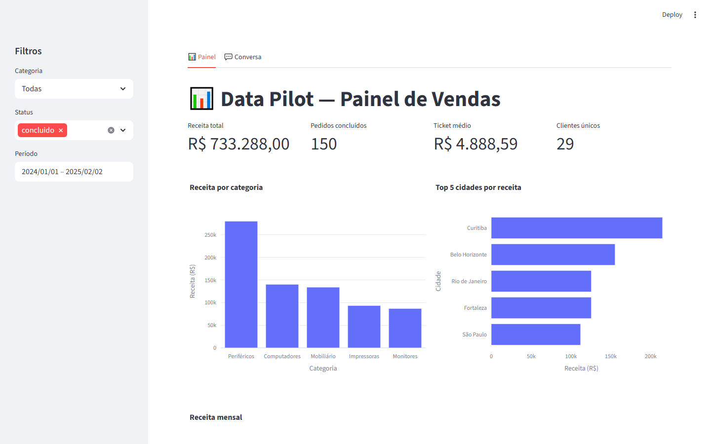
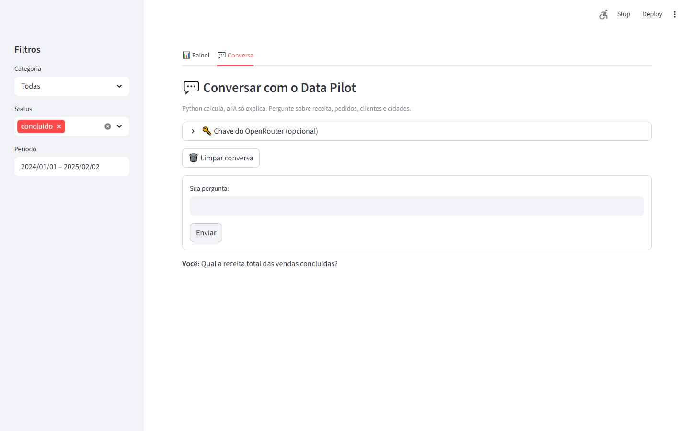
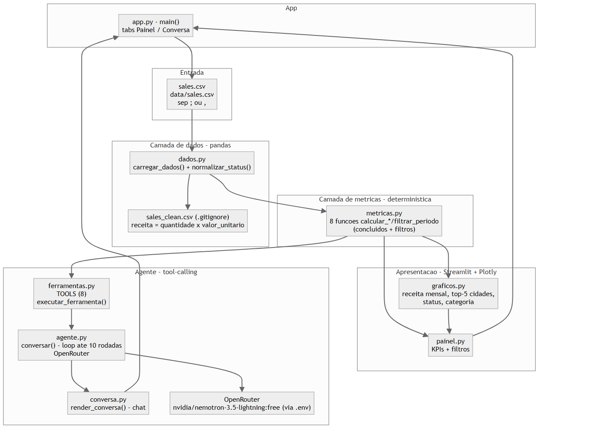

# data-pilot

<div align="center">

[English](README.en.md) · **Português (Brasil)**

</div>

[](https://www.python.org/) [](https://pandas.pydata.org/) [](https://streamlit.io/) [](https://plotly.com/) [](https://openrouter.ai/) [](https://docs.pytest.org/) [](LICENSE)

### Projeto final DIO: Análise Inteligente de Dados com Agentes de IA

> **Descrição completa para a DIO:** painel de vendas interativo desenvolvido como **projeto final do desafio DIO de Data Pipeline / Agentic Coding**: dois menus (painel de negócio + conversa em linguagem natural), 8 funções determinísticas de métricas em Python (receita total, pedidos concluídos, ticket médio, clientes únicos, taxa de cancelamento, receita média por cliente, top-5 cidades por receita e filtro por período), 8 ferramentas de tool-calling expostas ao modelo, painel Streamlit com 4 KPIs e 4 gráficos Plotly, chat via OpenRouter com modelo **gratuito** `nvidia/nemotron-3.5-lightning:free`, arquivo de configuração `.env` ignorado pelo Git, 70 testes automatizados e prints reais do aplicativo: tudo para demonstrar na prática a regra “Python calcula, a IA só explica”.

---

## O que é

**Data Pilot**: um painel de vendas em Python que, além de mostrar as métricas, também *conversa* com você em português. Você pergunta em linguagem natural e um agente de IA responde usando **apenas números calculados pelo seu próprio código** (pandas): a IA explica; ela não inventa.

Arquitetura em camadas, sem framework de agentes:
1. **Dado** (`pandas`): limpa `sales.csv` e gera `sales_clean.csv`;
2. **Métricas**: uma função Python por pergunta de negócio, sempre sobre pedidos concluídos;
3. **Painel** (`Streamlit` + `Plotly`): KPIs, gráfico de receita mensal e Top-5 cidades;
4. **Chat** (`OpenRouter` + modelo gratuito): o modelo escolhe **sozinho** qual ferramenta chamar (tool-calling).

---

## Início Rápido

```bash
git clone https://github.com/KelvinOliveiraCode/data-pilot.git
cd data-pilot
python -m venv .venv
.venv\Scripts\Activate.ps1   # Windows; no Linux/macOS: source .venv/bin/activate
pip install -r requirements.txt
# ou, instalando o pacote com o comando `data-pilot`:
pip install -e .
copy .env.example .env       # ou: cp .env.example .env
# edite o .env com sua chave do OpenRouter (OPENROUTER_API_KEY) e o modelo gratuito
#   OPENROUTER_MODEL=nvidia/nemotron-3.5-lightning:free
streamlit run src/data_pilot/app.py
# ou, após `pip install -e .`:
data-pilot
```

> Sem chave, o **Painel** funciona normalmente e o **Chat** indica como configurar. Sem `data/sales.csv`, o app gera um CSV sintético determinístico (fallback) e avisa.
>
> Origem do dado: `data/sales.csv` (planilha de vendas do desafio; separador `;` ou `,`). O código limpa com pandas (`dados.py` → `carregar_dados`), deduplica por `pedido_id` e gera `data/sales_clean.csv` (em `.gitignore`).

---

## Como funciona

Regra central: **o Python calcula, a IA só explica.**

- O modelo nunca recebe a planilha crua: só o resultado numérico de uma função.
- Cada função de métrica (`calcular_receita_total`, `calcular_ticket_medio`, …) é registrada como **ferramenta** (nome, descrição, parâmetros).
- O LLM escolhe qual ferramenta chamar; o código a executa localmente e devolve o número; o modelo só formata a frase final.
- O log da conversa mostra **qual função foi executada, com quais parâmetros e qual resultado**: evidência de que os números são reais.

---

## Capacidades

| Capacidade | Descrição |
|------------|-------------|
| Limpeza de dados | Datas convertidas, status padronizados, duplicados removidos, coluna `receita`; salva `sales_clean.csv` com `;` e decimal `,` |
| Métricas de negócio | Receita total, pedidos, ticket médio, clientes únicos, taxa de cancelamento: sempre sobre pedidos concluídos |
| Painel interativo | Cards (KPIs), filtro por categoria, gráfico de receita mensal (Plotly) |
| Chat com ferramentas | Perguntas em PT → modelo chama a função certa (tool-calling) → resposta com números do código |
| Modelo gratuito | OpenRouter (`nvidia/nemotron-3.5-lightning:free`) com suporte a tool-calling, chave em `.env` |
| Testes | `pytest` cobrindo limpeza, métricas, paridade painel ≡ chat e contratos das ferramentas |

---

## Estrutura do projeto

```
data-pilot/
├── app.py
├── .env.example
├── requirements.txt
├── pyproject.toml
├── data/
│   └── sales.csv            # planilha de vendas (original do desafio)
├── src/data_pilot/
│   ├── dados.py             # limpeza com pandas
│   ├── metricas.py          # funções de negócio determinísticas
│   ├── ferramentas.py       # descritores das ferramentas (tool-calling)
│   ├── agente.py            # loop do agente via OpenRouter
│   ├── graficos.py          # Plotly (receita mensal + Top-5 cidades)
│   ├── painel.py            # página do painel (Streamlit)
│   └── conversa.py          # página do chat (Streamlit)
├── tests/
│   ├── test_dados.py
│   ├── test_metricas.py
│   └── test_ferramentas.py
└── docs/prints/
    ├── painel.png
    ├── conversa.png
    └── arquitetura.png
```

> Diagrama fonte: [docs/architecture.mermaid](docs/architecture.mermaid) (fluxo: dados.py → metricas.py → painel.py/graficos.py → agente.py/ferramentas.py).

---

## Prints

### Painel



### Conversa respondida com ferramenta



### Arquitetura



> Prints completados após rodar o app; instruções em [docs/prints/README.md](docs/prints/README.md).
> Diagrama fonte: [docs/architecture.mermaid](docs/architecture.mermaid).

---

## Ferramentas do modelo (tool-calling)

O modelo chama **nomes snake_case** (definidos em `src/data_pilot/ferramentas.py`, `TOOLS`); as
`calcular_*` são as funções internas em `metricas.py` que eles despacham para.

| Nome (tool) | Função interna | O que calcula | Parâmetros |
|--------|---------------|------------|
| `receita_total` | `calcular_receita_total` | Receita de pedidos concluídos | `categoria` (opcional) |
| `pedidos_concluidos` | `calcular_pedidos_concluidos` | Número de pedidos concluídos | `categoria` (opcional) |
| `ticket_medio` | `calcular_ticket_medio` | Receita ÷ pedidos | `categoria` (opcional) |
| `clientes_unicos` | `calcular_clientes_unicos` | Clientes distintos com pedido concluído | `categoria` (opcional) |
| `taxa_cancelamento` | `calcular_taxa_cancelamento` | Cancelados ÷ total (0–100 %) | `categoria` (opcional) |
| `receita_media_por_cliente` | `calcular_receita_media_por_cliente` | Receita ÷ clientes únicos | `categoria` (opcional) |
| `top5_cidades_receita` | `calcular_top5_cidades_receita` | Top-5 cidades por receita | nenhum |
| `filtrar_periodo` | `filtrar_periodo` | Registros filtrados por período | `data_inicio`/`data_fim`/`categoria` (opcionais) |

---

## Melhoria escolhida

> **Métrica nova + gráfico novo + ferramenta com período**: receita média por cliente, top-5 cidades por receita (gráfico das 5 cidades que mais vendem) e uma ferramenta que aceita período/filtro por período (`data_inicio`/`data_fim`): tudo calculado no código e respondido no chat.

---

## Projeto final DIO

Projeto desenvolvido como **projeto final da trilha DIO de Data Pipeline / Agentic Coding**
([Digital Innovation One](https://www.dio.me/)): entregues:

- **Painel de negócio** (Streamlit + Plotly): KPIs de receita total, pedidos concluídos, ticket médio e clientes únicos, com filtros de categoria, período e status, além de gráficos de receita por categoria, top-5 cidades por receita, receita mensal e distribuição de pedidos por status.
- **Chat em linguagem natural** (OpenRouter, modelo gratuito `nvidia/nemotron-3.5-lightning:free`): o usuário pergunta em português e o agente responde citando apenas números produzidos por funções Python (`receita_total`, `pedidos_concluidos`, `ticket_medio`, `clientes_unicos`, `taxa_cancelamento`, `receita_media_por_cliente`, `top5_cidades_receita`, `filtrar_periodo`).
- **Arquitetura sem framework de agentes**: `pandas` limpa e enriquece o CSV (`;` ou `,`), 8 funções determinísticas respondem cada pergunta de negócio, o painel e o chat compartilham as mesmas funções: números idênticos nos dois menus.
- **Qualidade**: 70 testes automatizados (dados, métricas, ferramentas, gráficos, painel/conversa e integração), `ruff` limpo, `.env` ignorado pelo Git (só existe `.env.example`), `data/sales.csv` com fallback sintético determinístico e prints reais em `docs/prints/`.
- **Regra central demonstrada**: Python calcula, a IA só explica: o modelo escolhe qual ferramenta executar, mas nunca inventa números.

---

## Perguntas Frequentes

<details>
<summary><strong>Onde ficam os dados?</strong></summary>

Em `data/sales.csv` (planilha de vendas do desafio). O app limpa com pandas e gera `data/sales_clean.csv`.
</details>

<details>
<summary><strong>Preciso de chave de API?</strong></summary>

Só para o Chat. Crie conta no OpenRouter e preencha `OPENROUTER_API_KEY` no `.env` (copie de `.env.example`). O Painel funciona sem chave.
</details>

<details>
<summary><strong>Como testar?</strong></summary>

```bash
pytest -q
ruff check .
```
</details>

<details>
<summary><strong>Posso usar em produção?</strong></summary>

Este é um **projeto de estudo/portfólio**. Endureça (secrets, rate-limit, observabilidade) antes de qualquer uso em produção.
</details>

---

## Documentação

- **Código-Fonte**: Navegue pelo diretório `src/` para detalhes de implementação
- **Referência da API**: Docstrings inline + type hints
- **Diagrama de Arquitetura**: Veja [architecture.mermaid](docs/architecture.mermaid)
- **Changelog**: [CHANGELOG.md](CHANGELOG.md) (se presente)
- **Contribuindo**: [CONTRIBUTING.md](CONTRIBUTING.md) (se presente)

## Licença

[MIT](LICENSE) · Kelvin Oliveira

---

<div align="center">

**Construído com** · Python 3 + pandas + Streamlit + Plotly + OpenRouter

**Autor** · [Kelvin Oliveira](https://github.com/KelvinOliveiraCode) · [Portfolio](https://kelvinoliveiracode.github.io/portfolio/)

</div>
